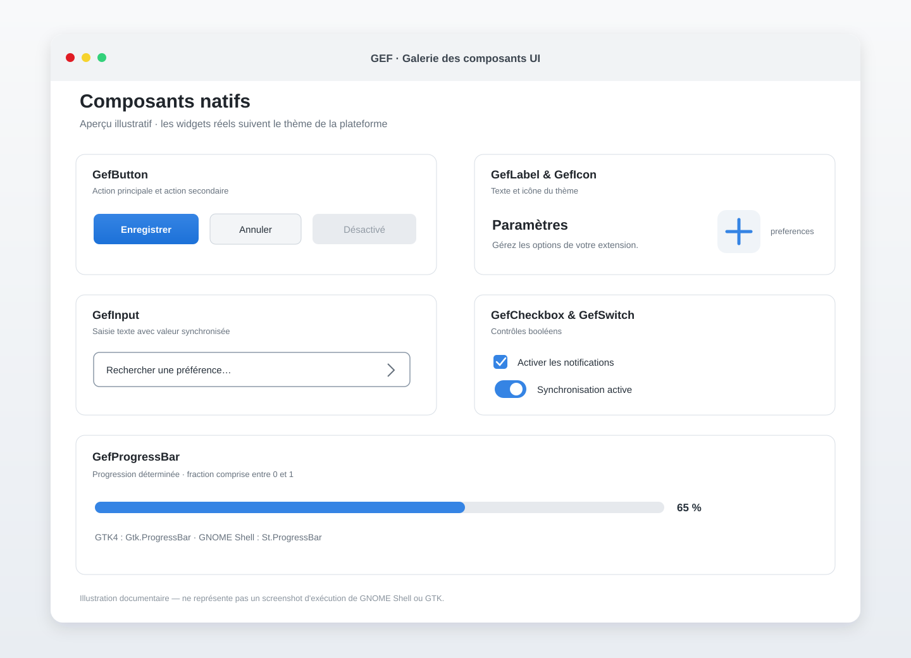

# GEF UI — guide complet

Ce guide décrit la bibliothèque UI livrée avec GEF, ses composants natifs, leur utilisation depuis GTPL et les différences entre GNOME Shell (St) et GTK4.

> **État du projet :** GEF est en alpha. Les composants présentés ici sont ceux effectivement exportés par `gnome-extension-framework/ui`. Les exemples GTPL utilisent les conteneurs natifs exposés par le renderer. Les composants `Gef*` sont des composants réutilisables à enregistrer dans le `ComponentRegistry` de la plateforme.

## Démonstrations natives

Le [GEF Kitchen Sink](../packages/examples/kitchen-sink/README.md) est la galerie de référence : une application GTK4 qui monte un template GTPL et réunit les widgets GTK actuellement pris en charge, les contrôles de saisie, les conteneurs Flex/Grid, HeaderBar et Sidebar. Lancez-la avec `npm run build:kitchen-sink`, puis `gjs -m packages/examples/kitchen-sink/kitchen-sink.js`.

Le [GTK UI Showcase](../packages/examples/ui-showcase/README.md) reste un exemple minimal. La galerie SVG ci-dessous est une planche illustrative, pas une capture d'écran d'exécution.

## Aperçu visuel



Cette galerie est une **planche illustrative** dessinée pour la documentation. Elle n'est pas une capture d'écran prise dans GNOME Shell ou GTK. Les composants sont rendus par des widgets natifs différents selon la plateforme ; les captures d'exécution réelles doivent être prises dans l'environnement cible.

## Sommaire

- [Installation et imports](#installation-et-imports)
- [Enregistrer les composants](#enregistrer-les-composants)
- [Catalogue](#catalogue)
- [Exemples GTPL](#exemples-gtpl)
- [Conteneurs et mise en page](#conteneurs-et-mise-en-page)
- [Réactivité et événements](#réactivité-et-événements)
- [Compatibilité des plateformes](#compatibilité-des-plateformes)
- [Bonnes pratiques](#bonnes-pratiques)
- [Limites connues](#limites-connues)

## Installation et imports

Dans une extension GEF, importer les composants depuis l'entrée UI :

```ts
import {
  GefButton,
  GefLabel,
  GefIcon,
  GefInput,
  GefCheckbox,
  GefSwitch,
  GefProgressBar,
  createStUiRegistry,
  createGtkUiRegistry,
} from 'gnome-extension-framework/ui';
```

Les classes `Gef*` décrivent l'API publique des composants. Elles ne créent pas seules un widget : le registre de plateforme fournit le rendu natif et relie les propriétés et événements.

## Enregistrer les composants

Pour GNOME Shell, créer un registre St :

```ts
import { createStUiRegistry } from 'gnome-extension-framework/ui';

const components = createStUiRegistry();
// Fournir ce registre au runtime GTPL de l'extension.
```

Pour une application GTK4 / libadwaita :

```ts
import { createGtkUiRegistry } from 'gnome-extension-framework/ui';

const components = createGtkUiRegistry();
// Fournir ce registre au runtime GTPL de l'application.
```

N'enregistrez que le registre correspondant à la plateforme courante. Le framework conserve ainsi une API de composants commune sans prétendre que les widgets GTK et St sont identiques.

## Catalogue

### GefButton

Bouton d'action natif.

| Propriété | Type | Défaut | Description |
| --- | --- | --- | --- |
| `label` | `string` | `''` | Texte affiché |
| `disabled` | `boolean` | `false` | Désactive l'action |

| Événement | Valeur émise |
| --- | --- |
| `clicked` | `void` |

```html
<GefButton label="Enregistrer" (clicked)="save()" />
<GefButton label="Supprimer" disabled="true" />
```

Rendu : `Gtk.Button` sous GTK4 ; `St.Button` sous GNOME Shell.

### GefLabel

Texte non éditable.

| Propriété | Type | Défaut |
| --- | --- | --- |
| `text` | `string` | `''` |

```html
<GefLabel text="Préférences" />
```

Rendu : `Gtk.Label` ou `St.Label`.

### GefIcon

Icône du thème courant.

| Propriété | Type | Défaut |
| --- | --- | --- |
| `iconName` | `string` | `''` |

```html
<GefIcon iconName="document-save-symbolic" />
```

Rendu : `Gtk.Image` ou `St.Icon`. Utilisez de préférence les noms d'icônes symboliques disponibles dans le thème GNOME actif.

### GefInput

Champ de saisie texte.

| Propriété | Type | Défaut | Description |
| --- | --- | --- | --- |
| `value` | `string` | `''` | Valeur courante |

| Événement | Valeur émise |
| --- | --- |
| `valueChange` | `string` |

```html
<GefInput value="Nom de l'extension" (valueChange)="onNameChange($event)" />
```

Rendu : `Gtk.Entry` ou `St.Entry`. La valeur est synchronisée avec le composant et l'événement `valueChange` transmet la nouvelle chaîne.

### GefCheckbox

Case à cocher.

| Propriété | Type | Défaut |
| --- | --- | --- |
| `checked` | `boolean` | `false` |

| Événement | Valeur émise |
| --- | --- |
| `checkedChange` | `boolean` |

```html
<GefCheckbox checked="true" (checkedChange)="onEnabledChange($event)" />
```

Rendu : `Gtk.CheckButton` ou `St.CheckBox`.

### GefSwitch

Interrupteur marche/arrêt.

| Propriété | Type | Défaut |
| --- | --- | --- |
| `active` | `boolean` | `false` |

| Événement | Valeur émise |
| --- | --- |
| `activeChange` | `boolean` |

```html
<GefSwitch active="true" (activeChange)="onNotificationsChange($event)" />
```

Rendu : `Gtk.Switch` ou `St.Switch`. La propriété publique reste `active` ; le renderer GNOME Shell la relie à l'état natif `state`.

### GefProgressBar

Indicateur de progression déterminé.

| Propriété | Type | Défaut | Description |
| --- | --- | --- | --- |
| `fraction` | `number` | `0` | Progression entre 0 et 1 |

```html
<GefProgressBar fraction="0.65" />
```

Rendu : `Gtk.ProgressBar` ou `St.ProgressBar`. La fraction représente 65 % dans cet exemple.

## Exemples GTPL

### Formulaire de préférences

```html
<Flex direction="column" gap="12">
  <GefLabel text="Préférences" />
  <GefInput value="Mon extension" (valueChange)="onNameChange($event)" />
  <GefCheckbox checked="true" (checkedChange)="onTelemetryChange($event)" />
  <Flex direction="row" gap="8">
    <GefButton label="Annuler" (clicked)="cancel()" />
    <GefButton label="Enregistrer" (clicked)="save()" />
  </Flex>
</Flex>
```

### Paramètres avec interrupteur et progression

```html
<Flex direction="column" gap="8">
  <GefLabel text="Notifications" />
  <GefSwitch active="true" (activeChange)="setNotifications($event)" />
  <GefLabel text="Téléchargement" />
  <GefProgressBar fraction="0.4" />
</Flex>
```

### Barre d'en-tête et navigation latérale

```html
<Flex direction="column" gap="0">
  <HeaderBar>
    <GefLabel text="Mon extension" />
    <GefButton label="Paramètres" (clicked)="openSettings()" />
  </HeaderBar>
  <Flex direction="row" gap="12">
    <Sidebar>
      <GefButton label="Accueil" (clicked)="showHome()" />
      <GefButton label="Préférences" (clicked)="showPreferences()" />
    </Sidebar>
    <Flex direction="column" gap="8">
      <GefLabel text="Bienvenue" />
      <GefLabel text="Contenu de la page" />
    </Flex>
  </Flex>
</Flex>
```

Les attributs d'événement GTPL suivent la syntaxe `(event)="method($event)"`. Les noms de méthodes et variables de ces exemples sont à définir dans le contexte de votre composant ou de votre vue.

## Conteneurs et mise en page

Les conteneurs sont des éléments GTPL natifs ; ils ne font pas partie des classes `Gef*` :

| Élément | Usage | GTK4 | GNOME Shell |
| --- | --- | --- | --- |
| `Flex` | Empiler des enfants en ligne ou colonne | `Gtk.Box` | `St.BoxLayout` |
| `Grid` | Disposer des enfants en colonnes | `Gtk.Grid` | Lignes imbriquées de `St.BoxLayout` |
| `HeaderBar` | Barre d'en-tête | `Adw.HeaderBar`, `Gtk.HeaderBar` ou fallback | `St.BoxLayout` horizontal |
| `Sidebar` | Navigation verticale | `Gtk.Box` vertical | `St.BoxLayout` vertical |

### Flex

```html
<Flex direction="column" gap="12">
  <GefLabel text="Compte" />
  <GefInput value="utilisateur" />
  <Flex direction="row" gap="8" homogeneous="true">
    <GefButton label="Retour" />
    <GefButton label="Continuer" />
  </Flex>
</Flex>
```

Attributs GTPL disponibles :

- `direction="row|column"` : orientation.
- `gap="8"` : espacement en pixels, valeur numérique non négative.
- `homogeneous="true|false"` : partage homogène de l'espace entre les enfants.
- `align="fill|start|center|end"` : alignement du conteneur dans son parent.
- `expand="true|false"` sur un enfant : demande d'expansion sur les deux axes.

### Grid

```html
<Grid columns="2" gap="12">
  <GefButton label="Général" />
  <GefButton label="Apparence" />
  <GefButton label="Réseau" />
  <GefButton label="À propos" />
</Grid>
```

`columns` doit être un entier positif. `gap` applique l'espacement horizontal et vertical. Le renderer GNOME Shell construit des lignes de boîtes car St 51 ne fournit pas de widget Grid natif.

Pour les calculs responsive indépendants du renderer, consulter le [guide Flex, Grid et responsive](ui-layout.md). Les breakpoints et moteurs de calcul TypeScript ne signifient pas que les widgets GTPL se réorganisent automatiquement au redimensionnement.

## Réactivité et événements

Les registres relient les propriétés publiques aux propriétés natives via des bindings. Les modifications venant du widget remontent via les événements `*Change` correspondants. Les abonnements sont détenus par le cycle de vie du composant et doivent être détruits avec la vue.

Exemple de liaison d'événement :

```html
<GefInput (valueChange)="updateSearch($event)" />
<GefSwitch (activeChange)="toggleFeature($event)" />
<GefButton (clicked)="apply()" />
```

Pour les syntaxes de binding, expressions, conditions et boucles, consulter le [guide GTPL](gtpl-language.md).

## Compatibilité des plateformes

| Composant | GTK4 | GNOME Shell 51 |
| --- | --- | --- |
| Bouton | Gtk.Button | St.Button |
| Label | Gtk.Label | St.Label |
| Icône | Gtk.Image | St.Icon |
| Saisie | Gtk.Entry | St.Entry |
| Case à cocher | Gtk.CheckButton | St.CheckBox |
| Interrupteur | Gtk.Switch | St.Switch |
| Progression | Gtk.ProgressBar | St.ProgressBar |

Les apparences, tailles, animations, thèmes et détails d'accessibilité restent ceux du toolkit natif. Le framework uniformise les propriétés et événements documentés, pas le pixel-perfect entre GTK et St.

## Bonnes pratiques

1. Utiliser les noms d'icônes symboliques du thème GNOME.
2. Préférer `GefSwitch` pour une préférence binaire activable et `GefCheckbox` pour une option indépendante.
3. Garder les labels explicites et les actions nommées par leur intention.
4. Utiliser `fraction` entre 0 et 1 pour la progression.
5. Laisser les widgets natifs gérer les états clavier, focus et thème lorsque possible.
6. Détruire les vues et registres au bon moment du cycle de vie.
7. Vérifier les vues dans les deux environnements : GTK4/libadwaita et GNOME Shell 51.

## Limites connues

- La bibliothèque UI comprend actuellement sept composants `Gef*` : Button, Label, Icon, Input, Checkbox, Switch et ProgressBar.
- Les conteneurs Flex/Grid sont des éléments GTPL natifs, pas des composants de la bibliothèque `Gef*`.
- Le retour à la ligne Flex, les poids `grow` par enfant et une justification commune GTK/St ne sont pas exposés dans le renderer GTPL.
- Les breakpoints et calculs responsive sont disponibles dans l'API de layout, mais la reconfiguration native automatique à chaque changement de taille n'est pas fournie par ces exemples.
- Les visuels de cette page sont des illustrations de documentation et non des captures prises sur un bureau GNOME réel.

